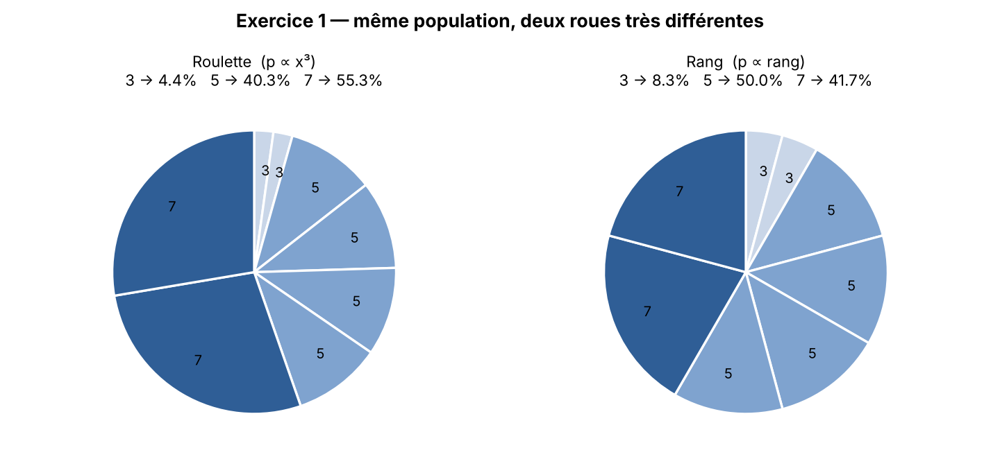
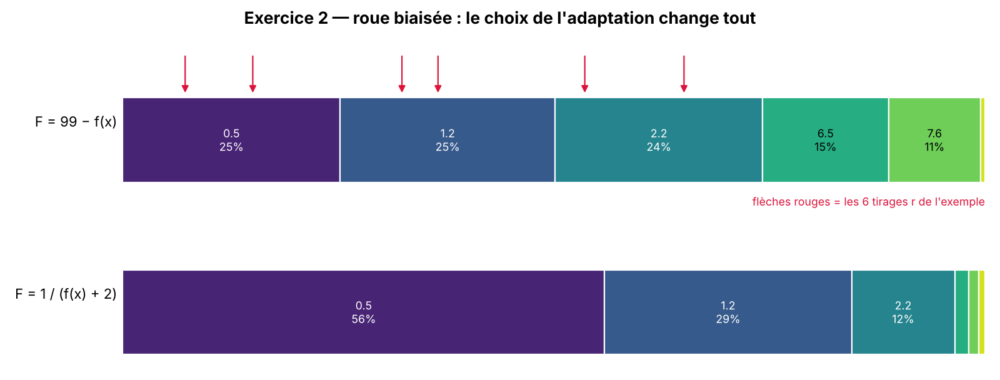
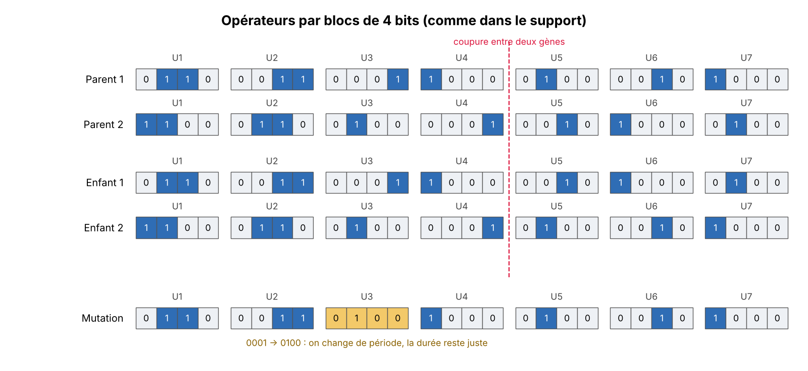
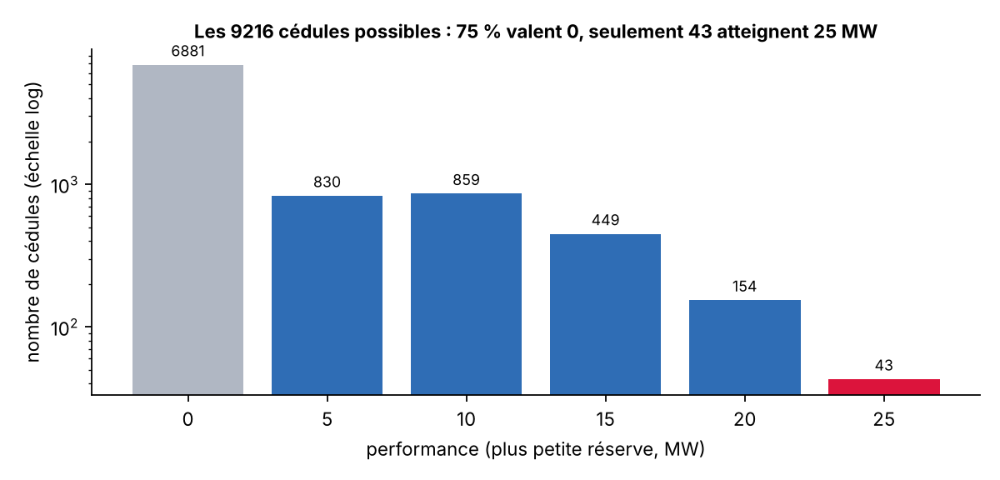
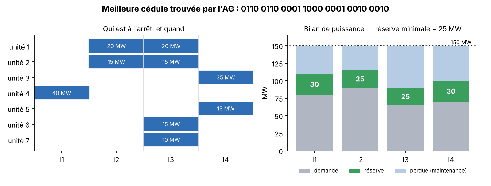
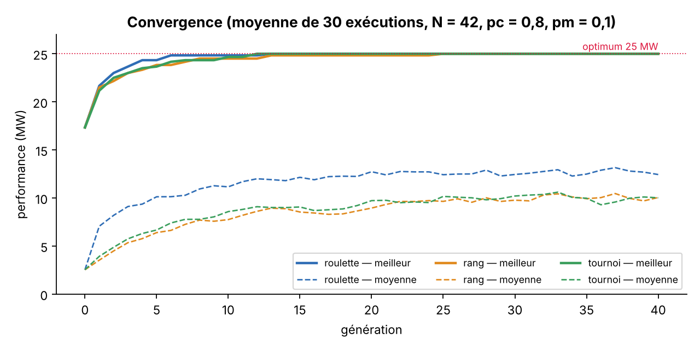
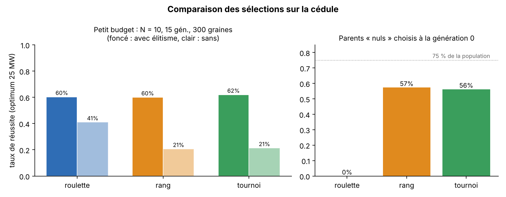
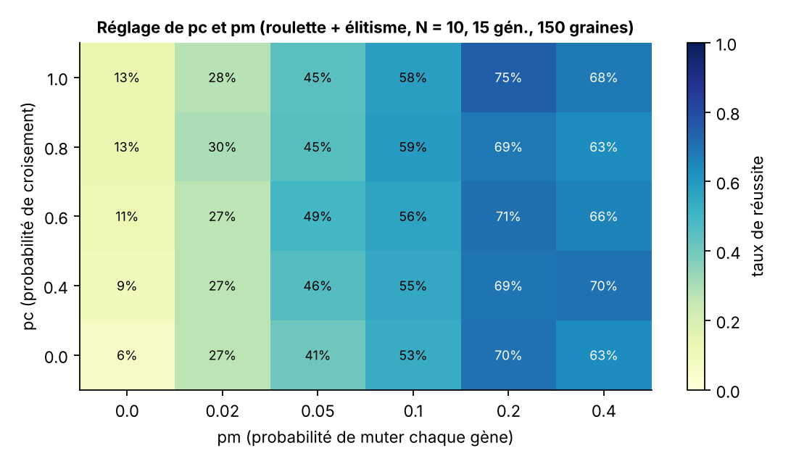

# TD3 – Algorithmes génétiques : sélection & cédule de maintenance

Faculté des Sciences de Sfax — Algorithmes évolutionnaires.

Ce dossier regroupe ma correction du **TD3** (exercices 1, 2 et 3 sur la sélection) et l'application
vue en cours : **la cédule de maintenance de centrales électriques**. J'ai voulu que les deux parties
se répondent : les fonctions de sélection écrites pour les exercices sont exactement celles que
j'utilise ensuite dans l'AG de la cédule, ce qui m'a permis de vérifier en pratique ce que les
calculs « à la main » laissaient deviner.

Tous les chiffres de ce compte rendu sortent du code (fichiers dans `sorties/`), rien n'est recopié
à la main sans vérification.

## Contenu

| Fichier | Rôle |
|---|---|
| `selection.py` | Roulette, roue biaisée (avec trace), rang, tournoi, élitisme |
| `exercices.py` | Calculs des exercices 1, 2 et 3 |
| `cedule.py` | Modèle de la cédule + algorithme génétique |
| `experiences.py` | Toutes les figures et les expériences |
| `figures/` | Les graphes utilisés ci-dessous |
| `sorties/` | Sorties console complètes |

```bash
# depuis la racine du dépôt
python -m td3_cedule.exercices      # exercices 1 à 3
python -m td3_cedule.cedule         # AG de la cédule
pip install matplotlib
python -m td3_cedule.experiences    # régénère figures/ et sorties/ (~10 s)
```

---

## Exercice 1 — roulette et rang sur 3 3 5 5 5 5 7 7, f(x) = x³

### 1) Roulette

On commence par évaluer chaque individu :

| x | f(x) = x³ | nombre de copies | total |
|---|---|---|---|
| 3 | 27 | 2 | 54 |
| 5 | 125 | 4 | 500 |
| 7 | 343 | 2 | 686 |
| | | **somme** | **1240** |

Avec la roulette, p(i) = f(i) / Σf. L'énoncé dit « chacun des individus 3, 5 et 7 », et il y a
deux lectures possibles : la chance de tirer **une copie précise**, ou la chance de tirer **la valeur**
(n'importe laquelle de ses copies). Je donne les deux, la seconde étant la plus utile :

| x | une copie | toutes les copies |
|---|---|---|
| 3 | 27/1240 ≈ 0,0218 | 54/1240 = 27/620 ≈ **0,0435** |
| 5 | 125/1240 ≈ 0,1008 | 500/1240 = 25/62 ≈ **0,4032** |
| 7 | 343/1240 ≈ 0,2766 | 686/1240 = 343/620 ≈ **0,5532** |

Le 7 n'est que 2 fois sur 8 dans la population, mais il récupère plus de la moitié de la roue.
C'est l'effet du x³ : l'écart entre les individus est amplifié.

### 2) Rang

On classe du moins bon au meilleur et on donne le rang 1 au moins bon, le rang 8 au meilleur.
Petite difficulté : il y a des ex aequo. Je donne à des individus identiques **la moyenne des rangs
qu'ils occupent** (sinon deux 3 identiques n'auraient pas la même chance, ce qui n'a pas de sens) :

- les deux 3 occupent les rangs 1 et 2 → 1,5 chacun ;
- les quatre 5 occupent les rangs 3 à 6 → 4,5 chacun ;
- les deux 7 occupent les rangs 7 et 8 → 7,5 chacun.

Σ rangs = 1 + 2 + … + 8 = 36, et p(i) = rang(i) / 36 :

| x | une copie | toutes les copies |
|---|---|---|
| 3 | 1,5/36 ≈ 0,0417 | 3/36 = 1/12 ≈ **0,0833** |
| 5 | 4,5/36 = 0,125 | 18/36 = **0,5** |
| 7 | 7,5/36 ≈ 0,2083 | 15/36 = 5/12 ≈ **0,4167** |

(On remarque que les totaux par valeur ne dépendent pas de la façon de traiter les ex aequo :
1 + 2 = 3, 3 + 4 + 5 + 6 = 18, 7 + 8 = 15.)



**Ce que j'en retiens :** le rang « écrase » les écarts. Le 7 passe de 55 % à 42 %, le 3 double ses
chances (4 % → 8 %). La sélection par rang limite la domination d'un super-individu et donc la
convergence prématurée ; en contrepartie, elle ne tient plus compte de *combien* un individu est
meilleur, seulement de *s'il* est meilleur.

### 3) Les deux algorithmes

```
Algorithme SélectionRoulette(P[1..N], F[1..N])
    S ← F[1] + F[2] + ... + F[N]
    r ← nombre aléatoire uniforme dans [0, S[
    cumul ← 0
    pour i de 1 à N faire
        cumul ← cumul + F[i]
        si r < cumul alors retourner P[i]
    fin pour
    retourner P[N]                    { sécurité contre les arrondis }
Fin
```

```
Algorithme SélectionRang(P[1..N], F[1..N])
    trier les indices par F croissante          { O(N log N) }
    pour chaque groupe d'ex aequo occupant les places a..b faire
        R[i] ← (a + b) / 2  pour chaque i du groupe
    fin pour
    retourner SélectionRoulette(P, R)           { même roue, secteurs = rangs }
Fin
```

En Python : `selection_roulette` et `selection_rang` dans [`selection.py`](selection.py).

### 4) La génération t+1

Codage sur 4 bits : 3 = `0011`, 5 = `0101`, 7 = `0111`.

J'ai essayé tous les couples et toutes les coupures possibles (après le 1er, 2e ou 3e bit).
Le résultat est assez surprenant : **un seul croisement produit du nouveau** :

```
0011 x 0101, coupure après le 2e bit :  00|11 + 01|01  →  0001 (1)  et  0111 (7)
```

Tous les autres croisements redonnent les parents (par exemple `0011 x 0111` : les deux parents ne
diffèrent que sur le 2e bit, donc échanger les queues ne change rien).

- après croisement on peut donc avoir : **1, 3, 5, 7** ;
- si la mutation (inversion du dernier bit) s'applique, ils deviennent : **0, 2, 4, 6**.

**Individus possibles en t+1 : {0, 1, 2, 3, 4, 5, 6, 7}.**

Remarque importante : **le premier bit vaut 0 chez tous les parents**. Le croisement ne peut pas le
créer, et la mutation ne touche que le dernier bit. Donc les valeurs 8 à 15 sont inatteignables,
alors que le meilleur individu possible pour f(x) = x³ sur 4 bits est 15 (`1111`). C'est un exemple
concret de **perte de diversité** : avec une mutation aussi restreinte, l'AG reste enfermé dans le
schéma `0***`. Il faut une mutation qui puisse toucher n'importe quel bit.

---

## Exercice 2 — minimiser f(x) = x² − 1 sur [0, 10]

### Taille d'un individu

Les valeurs demandées ont une décimale, donc je prends une **précision de 0,1**. Sur [0, 10] cela
fait (10 − 0)/0,1 + 1 = **101 valeurs** à représenter.

2⁶ = 64 < 101 ≤ 128 = 2⁷  →  **il faut 7 bits.**

Codage : k = (x − 0)/0,1, écrit en binaire sur 7 bits ; décodage : x = 0 + k × 0,1.
(Les codes 101 à 127 ne correspondent à aucun x de l'intervalle ; il faudra les rejeter ou les
ramener à 10 si un croisement les produit.)

### Représentation, évaluation, adaptation

Comme on **minimise**, on ne peut pas mettre f(x) directement dans une roulette (f est même négative
en 0,5). Il faut une *adaptation* F positive, plus grande pour les meilleurs individus.
Mon choix principal : **F(x) = Cmax − f(x)** avec Cmax = max f sur [0, 10] = f(10) = 99.

| x | k | binaire (7 bits) | f(x) | F = 99 − f | p roulette |
|---|---|---|---|---|---|
| 0,5 | 5 | `0000101` | −0,75 | 99,75 | 0,2522 |
| 1,2 | 12 | `0001100` | 0,44 | 98,56 | 0,2492 |
| 2,2 | 22 | `0010110` | 3,84 | 95,16 | 0,2406 |
| 6,5 | 65 | `1000001` | 41,25 | 57,75 | 0,1460 |
| 7,6 | 76 | `1001100` | 56,76 | 42,24 | 0,1068 |
| 9,9 | 99 | `1100011` | 97,01 | 1,99 | 0,0050 |
| | | | | Σ = 395,45 | 1 |

Petit regret avec ce choix : 0,5 et 1,2 ont presque la même chance (25,2 % contre 24,9 %), alors
que 0,5 est clairement meilleur. J'ai donc comparé avec une autre adaptation classique,
**F = 1 / (f − fmin + 1) = 1 / (f + 2)** : là, 0,5 obtient 56 % de la roue et 1,2 seulement 29 %.



La morale : la roulette ne voit que l'adaptation, donc **la façon de transformer f est déjà un
réglage de la pression de sélection**.

### 1) Algorithme « roue biaisée de loterie » et déroulement

```
Algorithme RoueBiaisée(P[1..N], F[1..N], m)        { m = nombre de parents voulus }
    { préparation de la roue, faite une seule fois }
    C[1] ← F[1]
    pour i de 2 à N faire C[i] ← C[i-1] + F[i]
    { tirages }
    pour j de 1 à m faire
        r ← aléatoire uniforme dans [0, C[N][
        chercher le plus petit i tel que r < C[i]    { recherche dichotomique }
        Élus[j] ← P[i]
    fin pour
    retourner Élus
Fin
```

Déroulement sur les 6 individus (F = 99 − f), avec 6 tirages :

| individu | secteur sur la roue |
|---|---|
| 0,5 | [0 ; 99,75[ |
| 1,2 | [99,75 ; 198,31[ |
| 2,2 | [198,31 ; 293,47[ |
| 6,5 | [293,47 ; 351,22[ |
| 7,6 | [351,22 ; 393,46[ |
| 9,9 | [393,46 ; 395,45[ |

| tirage | r | secteur | individu choisi |
|---|---|---|---|
| 1 | 128,06 | 2 | 1,2 |
| 2 | 59,65 | 1 | 0,5 |
| 3 | 257,41 | 3 | 2,2 |
| 4 | 28,64 | 1 | 0,5 |
| 5 | 211,91 | 3 | 2,2 |
| 6 | 144,61 | 2 | 1,2 |

Les trois meilleurs sont choisis deux fois chacun, les trois mauvais disparaissent. Avec seulement
6 tirages c'est en partie de la chance (6,5 avait quand même 15 %), mais c'est bien la tendance
attendue. Les valeurs de r viennent de `random.Random(7)`, donc on retrouve exactement ce tableau
en relançant `python -m td3_cedule.exercices`.

### 2) Complexité

- Préparation de la roue (somme cumulée) : **O(N)**.
- Un tirage avec parcours linéaire : **O(N)** → pour N tirages : **O(N²)**.
- Un tirage avec recherche dichotomique dans C : **O(log N)** → pour N tirages :
  **O(N log N)** au total. C'est la version que j'ai codée (`roulette_biaisee`, avec `bisect`).
- Pour aller plus loin : le *stochastic universal sampling* fait les N tirages en un seul passage
  (O(N)), avec en plus moins de variance que N tirages indépendants.

---

## Exercice 3 — tournoi et élitisme

### 1) Sélection par tournoi

```
Algorithme SélectionTournoi(P[1..N], F[1..N], k)    { k = taille du tournoi, souvent 2 }
    meilleur ← indice aléatoire dans 1..N
    répéter k − 1 fois
        i ← indice aléatoire dans 1..N
        si F[i] > F[meilleur] alors meilleur ← i
    fin répéter
    retourner P[meilleur]
Fin
```

- Complexité : **O(k)** par sélection, indépendante de N, et aucun tri ni somme à calculer.
- Elle ne dépend que de l'ordre entre les adaptations, comme le rang : pas besoin que F soit positive,
  on peut même comparer directement les f(x) pour une minimisation.
- k règle la pression : k = 1 → hasard pur ; k grand → on prend presque toujours le meilleur.

### 2) Sélection par élitisme

```
Algorithme Élitisme(P[1..N], F[1..N], e)            { e = nombre d'élites, souvent 1 ou 2 }
    trier P par F décroissante
    retourner les e premiers                      { copiés SANS croisement ni mutation }
Fin

{ utilisation dans une génération }
Nouvelle ← Élitisme(P, F, e)
tant que |Nouvelle| < N faire
    p1, p2 ← sélection (roulette, rang ou tournoi)
    ajouter à Nouvelle les enfants de p1, p2 après croisement et mutation
fin tant que
```

- Complexité : O(N log N) avec un tri complet ; O(N) si e = 1 (un simple maximum).
- L'élitisme n'est pas une sélection « seule » : il se combine avec une autre méthode. Son rôle est
  de garantir que le meilleur individu ne se perd jamais, donc que la meilleure performance ne
  baisse jamais d'une génération à l'autre.

Sur les individus de l'exercice 2 (F = 99 − f) : six tournois de taille 2 donnent
1,2 ; 1,2 ; 2,2 ; 6,5 ; 0,5 ; 0,5, et l'élite de taille 2 est {0,5 ; 1,2}.

---

## Application : la cédule de maintenance

### Le problème

7 unités, 4 intervalles dans l'année, demandes 80, 90, 65 et 70 MW, capacité totale 150 MW.

| Unité | 1 | 2 | 3 | 4 | 5 | 6 | 7 |
|---|---|---|---|---|---|---|---|
| Capacité (MW) | 20 | 15 | 35 | 40 | 15 | 15 | 10 |
| Intervalles de maintenance | 2 | 2 | 1 | 1 | 1 | 1 | 1 |

Réserve(t) = 150 − puissance en maintenance(t) − demande(t), et la performance d'une cédule est la
**plus petite réserve** de l'année (0 si l'une est négative). On veut la maximiser.

### Codage et opérateurs

J'ai gardé le codage du support : un gène de 4 bits par unité, avec seulement les gènes
« légaux » (`1100 0110 0011` pour les unités 1-2, `1000 0100 0010 0001` pour les autres).

Avant de lancer quoi que ce soit, j'ai vérifié mon évaluation sur le chromosome d'exemple du cours,
`0110 0011 0001 1000 0100 0010 1000` : je trouve bien une puissance en maintenance de
50 / 35 / 50 / 50 MW, des réserves de 20 / 25 / 35 / 30 MW et une performance de **20 MW**, comme
dans le support.

Comme le dit le cours, croisement et mutation ne doivent **jamais couper un gène** :

- **croisement en un point**, la coupure tombe entre deux gènes (6 positions possibles) ;
- **mutation** : chaque gène a une probabilité pm d'être remplacé par une *autre* période valide
  pour la même unité (c'est exactement l'exemple `0001 → 0100` du support).



Avec ces opérateurs, un enfant est toujours une cédule correcte : pas besoin de réparation ni de
pénalité. J'ai préféré cette mutation à une inversion de gènes entre unités, parce qu'échanger les
gènes de deux unités de durées différentes oblige ensuite à « réparer » le gène, ce qui revient à
inventer une nouvelle période sans contrôle.

### Combien de cédules, et quel optimum ?

Le problème est petit : 3 × 3 × 4⁵ = **9 216 cédules**. Je les ai toutes évaluées, pour savoir
exactement où se trouve l'optimum et pouvoir juger l'AG honnêtement.



- L'optimum vaut **25 MW**, atteint par **43 cédules** seulement (0,47 %).
- **6 881 cédules (75 %) ont une performance nulle** : au moins un intervalle manque de puissance.

On peut aussi prouver que 25 est le maximum sans tout énumérer. Sur l'année, la puissance perdue
totale est 20×2 + 15×2 + 35 + 40 + 15 + 15 + 10 = 185 MW, donc la somme des 4 réserves vaut
4 × 150 − 185 − (80 + 90 + 65 + 70) = 110 MW, soit 27,5 en moyenne. Toutes les réserves sont des
multiples de 5, donc la plus petite ne peut pas dépasser 25.

### Résultat de l'AG

Paramètres : N = 42 (le cours conseille 6 à 7 fois le nombre de variables, ici 7), 60 générations,
pc = 0,8, pm = 0,1 par gène, sélection par roulette, élitisme de 1 individu.

```
Meilleure cédule : 0110 0110 0001 1000 0001 0010 0010
Réserves : [30, 25, 25, 30] -> performance = 25 MW
```



La logique de la solution se lit bien sur le graphe : l'intervalle 2 (demande 90 MW, le plus
chargé) ne peut se permettre que 35 MW de maintenance, et l'AG y a mis les unités 1 et 2 ;
la grosse unité 4 (40 MW) part en maintenance au premier intervalle, quand la demande n'est que de 80 MW,
et l'intervalle 3, le plus calme (65 MW), absorbe le maximum d'arrêts (60 MW).

### Convergence



Sur 30 exécutions, avec N = 42, **les trois sélections trouvent l'optimum à tous les coups**, en
quelques générations. Ce n'est pas étonnant : avec 43 optima sur 9 216, une population initiale de
42 individus en contient déjà un environ une fois sur cinq. Le meilleur de la génération 0 vaut en
moyenne 17,3 MW, puis 24,3 (roulette), 23,8 (rang) et 23,7 (tournoi) à la génération 5.

La différence visible est sur la **moyenne de la population** : la roulette la monte plus haut
(≈ 12,4 MW contre ≈ 10 MW). La population reste malgré tout assez « bruitée », ce qui est normal
avec pm = 0,1 sur 7 gènes : environ la moitié des enfants subissent au moins une mutation.

### Comparaison des sélections (budget réduit)

Pour voir de vraies différences, j'ai rendu la tâche difficile : **N = 10 et 15 générations**, et
300 graines par configuration.



| sélection | avec élitisme | sans élitisme |
|---|---|---|
| roulette | 60,3 % | 41,0 % |
| rang | 60,0 % | 20,7 % |
| tournoi (k = 2) | 62,0 % | 21,3 % |

Deux constats :

1. **L'élitisme est ce qui compte le plus.** Sans lui, on trouve parfois l'optimum… puis on le perd
   à la génération suivante. Avec lui, les trois méthodes se valent (≈ 60 %).
2. **Sans élitisme, la roulette fait deux fois mieux que le rang et le tournoi.** Au début je
   m'attendais à l'inverse (on dit souvent que la roulette est peu sélective). L'explication est
   sur le graphe de droite : à la génération 0, environ 75 % des individus ont une performance
   nulle. La roulette leur donne une probabilité **exactement nulle** (0 % des parents choisis),
   alors que le rang et le tournoi en choisissent encore 56-57 %. Ici, la roulette élimine
   d'office les cédules irréalisables : c'est elle qui exerce la plus forte pression.

C'est le genre de résultat qui montre qu'aucune sélection n'est « la meilleure » dans l'absolu :
tout dépend de la forme de la fonction d'adaptation.

### Réglage de pc et pm

Le cours insiste sur le fait qu'il ne faut pas se contenter d'une seule valeur de pc et pm.
Même budget réduit (N = 10, 15 générations, roulette + élitisme), 150 graines par case :



- **pm a beaucoup plus d'influence que pc.** Sans mutation (pm = 0) on plafonne à 6-13 %, parce que
  le croisement ne fait que recombiner les gènes déjà présents dans 10 individus.
- Le meilleur réglage est autour de **pm = 0,2 par gène** (≈ 70-75 %). À pm = 0,4 ça redescend un
  peu : l'AG devient presque une recherche aléatoire.
- pc change peu les résultats : même sans croisement (pc = 0) on atteint 70 % à pm = 0,2. Sur un
  problème aussi petit, la mutation suffit presque à explorer ; le croisement deviendrait plus utile
  avec beaucoup plus d'unités et d'intervalles.

### Limites et ce que je ferais ensuite

- Le problème est assez petit pour être résolu par énumération : l'AG est ici une démonstration.
  Il deviendrait vraiment utile avec, par exemple, 52 semaines et quelques dizaines d'unités
  (l'espace exploserait alors bien au-delà de ce qu'on peut énumérer).
- La performance « min des réserves » est très plate : 75 % des cédules valent 0, sans distinguer
  une cédule qui manque de 5 MW d'une qui manque de 60 MW. Garder la réserve négative (au lieu de
  la ramener à 0) donnerait à l'AG une direction pour sortir des zones irréalisables, mais il
  faudrait alors une sélection qui accepte des valeurs négatives (rang ou tournoi).
- Le modèle ignore les pannes et les délais d'équipements cités dans le support ; les ajouter
  rendrait la cédule plus réaliste.
